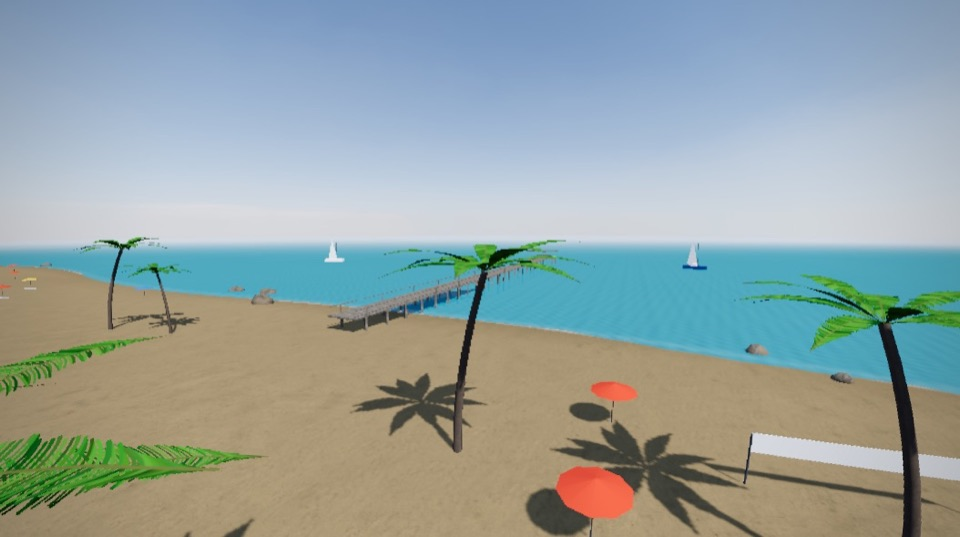
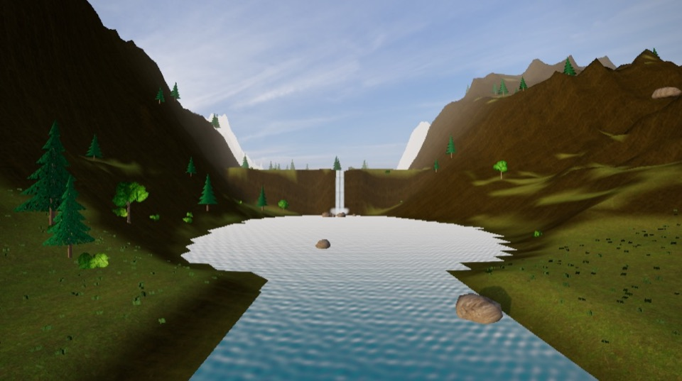
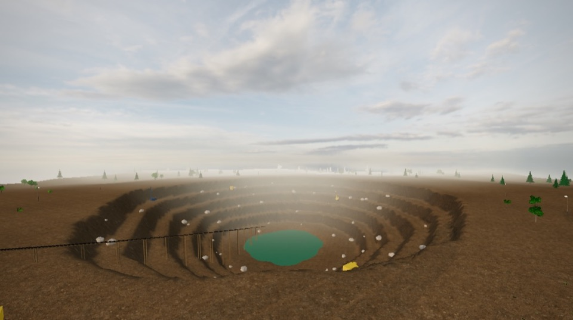
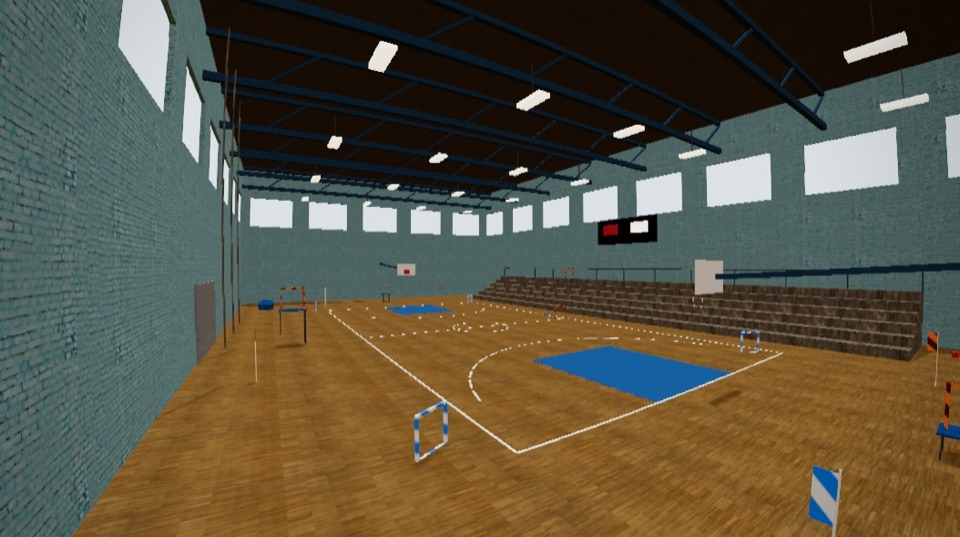
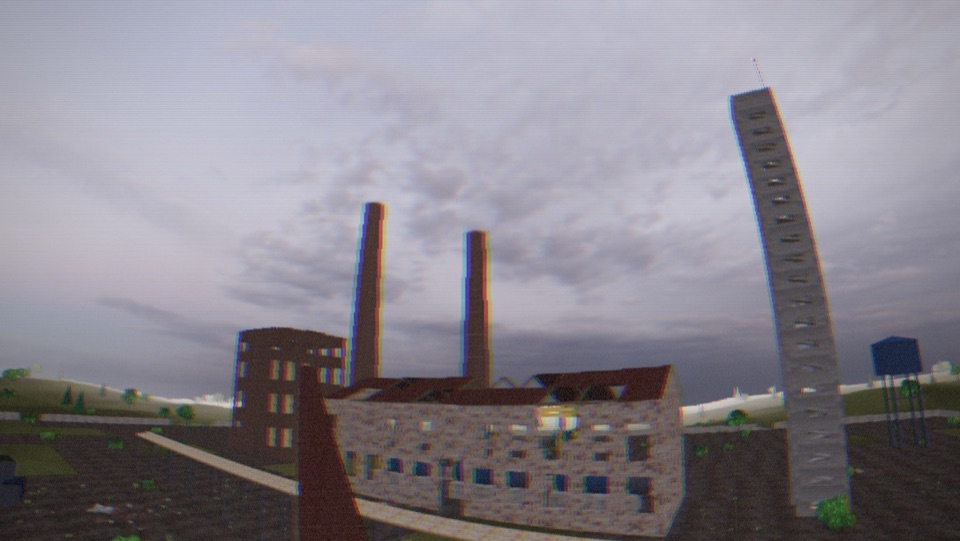
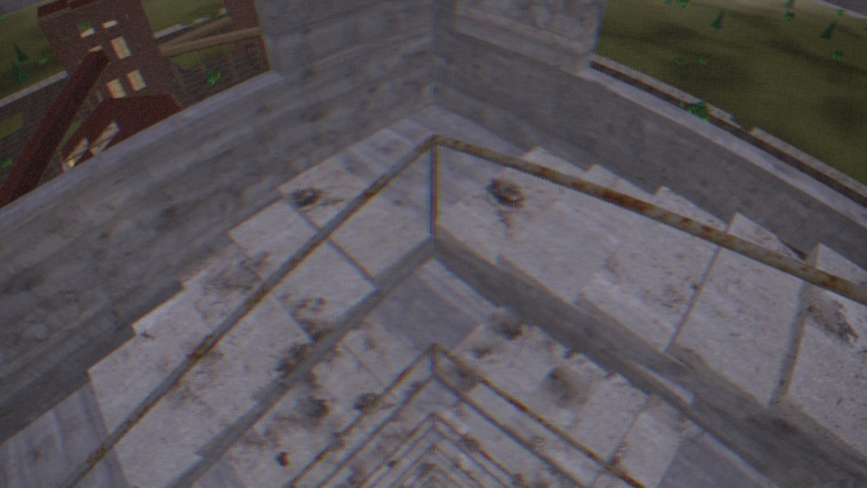

# FPVsim

Simulador de drone FPV em 3D que roda direto no navegador, com física realista, 9 cenários
e tudo configurável. Joga com controle de videogame (PS3, PS4, PS5, Xbox, Switch), com
rádio FPV de verdade ou com os sticks na tela do celular. 100% gratuito, sem instalar nada.

### ▶ Jogar: **https://joaomarcos91.github.io/fpvsim/**

> **English:** FPVsim is a free FPV drone simulator that runs in your browser — realistic
> physics, 9 maps (abandoned factory and power plant with hollow chimneys and a ladder-dive
> stairwell, mountains, race track, beach, quarry, indoor gym…) and every parameter tunable.
> Play with a gamepad (PS3/PS4/PS5, Xbox, Switch), a real FPV radio over USB (EdgeTX/OpenTX
> joystick mode) or the on-screen sticks on your phone. The game is in English whenever your
> browser isn't set to Portuguese (or switch it on the main menu / Settings → Audio / Game).
> Mode 2 controls: left stick throttle/yaw, right stick pitch/roll · **R1/RB** arm ·
> **△/Y** reset · **□/X** camera · **L1/LB** flight mode (start in Angle) · hold **✕/A** for
> turtle mode. Keyboard: W/S throttle, A/D yaw, arrows pitch/roll, Space to arm.


## Como jogar

1. Abra o link acima num navegador atualizado (Chrome, Edge, Firefox ou Safari).
   Clique em **⛶** (canto superior direito) para tela cheia.
2. Conecte o controle (USB ou Bluetooth) e **aperte qualquer botão** — o navegador só mostra o
   controle depois disso.
3. Escolha **Voar → cenário**, abaixe o throttle e aperte **R1** (ou **RB**) para armar.

**No celular ou tablet:** abra o link, deite o aparelho e use os sticks na tela — o esquerdo é
throttle (fica onde você soltar) e yaw, o direito é pitch e roll; toque em **ARMAR** com o
throttle embaixo. O celular já começa no modo Angle e no gráfico Baixo. No Android,
"Adicionar à tela inicial" abre o jogo em tela cheia. Um controle Bluetooth também funciona.

Nunca voou FPV? Aperte **L1** para trocar para o modo **Angle**, que nivela o drone sozinho.
No modo **Acro** (padrão) o drone fica no ângulo em que você deixar, como os drones reais
de freestyle.

> Se o 3D não aparecer, o navegador está sem WebGL2: ative a aceleração de hardware nas
> configurações dele ou tente outro navegador. Em Macs antigos o Safari costuma funcionar
> melhor que o Chrome.

## Controles

| Controle (Modo 2) | Ação |
|---|---|
| Stick esquerdo ↕ / ↔ | Throttle / Yaw |
| Stick direito ↕ / ↔ | Pitch / Roll |
| R1 / RB | Armar / desarmar (throttle embaixo) |
| △ / Y | Resetar o drone |
| □ / X | Câmera: FPV → terceira pessoa → linha de visada |
| L1 / LB | Modo de voo: Acro → Angle → Horizon |
| ✕ / A (segurar) | Turtle mode (desvirar depois de capotar) |
| D-pad ↑ / ↓ | Ângulo da câmera (uptilt) |
| D-pad ← / → | FOV |
| Options / Menu | Pausa. Nos menus: D-pad navega, ✕/A confirma, ○/B volta |

Teclado (reserva): W/S throttle, A/D yaw, setas pitch/roll, Espaço arma, R reset,
C câmera, M modo, T turtle, Esc pausa, `[` `]` uptilt, `,` `.` FOV.

Tela de toque: sticks e botões ARMAR, MODO, CÂM, RESET e pausa (Configurações → Controle →
Controles na tela: automático, sempre ou desligado, e tamanho).

O stick de um controle de videogame volta ao centro sozinho, então por padrão o centro é
50% de throttle (segure o stick). Em **Configurações → Controle** dá para usar só a metade
de cima do stick ou o gatilho **R2/RT** como throttle.

### Controles e rádios suportados

- **PlayStation 3, 4 e 5** (DualShock 3, DualShock 4, DualSense e DualSense Edge),
  **Xbox**, **Switch Pro** e controles genéricos. O jogo reconhece o modelo e mostra os nomes
  certos dos botões (✕○□△ ou A B X Y).
- **Rádios FPV** (RadioMaster, Jumper, FrSky, TBS, BetaFPV… com EdgeTX/OpenTX) ligados no USB
  em modo **Joystick (HID)**. Entram sozinhos no layout **AETR**, com **CH5** armando por chave
  mantida (igual ao Betaflight: se a chave já estiver ligada ao conectar, não arma),
  **CH6** trocando o modo de voo e **CH7** turtle. Também tem layout TAER.
- Cada controle/rádio guarda o próprio perfil (canais, botões, calibração). Qualquer botão
  ou chave pode ser remapeado, e "Detectar" descobre o eixo certo quando você mexe o stick.
- O PS3 depende do sistema reconhecer o controle (no Windows, com DsHidMini; no Linux,
  direto).

### Vibração (haptics)

Controles que vibram tremem nas batidas (proporcional ao impacto), forte no crash, e dão um
toque ao armar e ao passar pelos portões da corrida. Opcionalmente, também vibram
continuamente com os motores e a turbulência (propwash).

| Navegador | Vibração |
|---|---|
| Chrome / Edge | PS4, PS5, Xbox, Switch Pro. No Xbox, vibra também os **gatilhos** |
| Safari 16.4+ | PS4, PS5, Xbox |
| Firefox | Só se a vibração de gamepad estiver ligada no navegador |

Ajuste ou teste em **Configurações → Controle → Vibração**. Rádios FPV não vibram.

## Cenários

| | |
|---|---|
|  **Fábrica Abandonada** — galpão de tijolos com janelas quebradas e telhado furado, treliças, mezanino, contêineres e tanques. |  **A chaminé** — 50 m de altura, oca: entre por cima, mergulhe por dentro e saia pela porta na base. |
|  **Mergulho na chaminé** |  **Prédio Inacabado** — esqueleto de 12 andares, andaime, guindaste de 56 m e estacionamento. |
|  **Pista de Corrida** — 10 portões grandes (3,3 × 3 m), cronômetro e melhor volta salva. |  **Campos e Árvores** — fazenda, celeiro vazado, floresta, fios de alta tensão e lago. |
|  **Praia** — enseada com mar, coqueiros, píer de madeira (voe entre os pilares), farol num rochedo e barcos. |  **Vale nas Montanhas** — montanhas de até ~400 m com plataforma no pico para dives longos (com repetidora de vídeo), rio, cachoeira caindo num lago, ponte alta e pinheiros. |
|  **Pedreira** — cava em bancadas com lago no fundo, duas torres de resfriamento ocas de ~90 m (entre por baixo, entre os pilares, e saia pelo topo), britador, esteiras e caminhões. |  **Ginásio Indoor** — pista de tiny whoop cronometrada, arquibancada, cordas e cestas de basquete (passe pelo aro!). |
|  **Usina Abandonada** — duas chaminés ocas de 85 e 100 m, galeria da esteira para voar por dentro, caldeira e salão das turbinas. |  **Ladder dive** — torre de escada de 20 andares com poço aberto: entre pelo telhado, mergulhe pelo meio da escada e saia pela porta do térreo. |

## Conta (opcional · em breve)

Assim que as contas forem ativadas no site, o menu principal ganha **Entrar / criar conta**: só nome de usuário e senha — sem e-mail e sem
confirmação. Com a conta, as configurações, os **presets** (Configurações → Presets), os
mapeamentos de controle e as melhores voltas ficam salvos na nuvem e voltam em qualquer
computador ou celular. Os gráficos ficam em cada aparelho. Sem e-mail não há "esqueci a senha":
guarde a senha. Sem conta, tudo continua salvo no navegador.


- **Potência e velocidade máxima** (aba Física): "Potência" multiplica a força dos motores
  (mostra a relação empuxo/peso e o throttle de hover); "Velocidade máxima" você escolhe em
  km/h e o jogo ajusta o passo da hélice — e, acima de certo ponto, o arrasto — para o drone
  chegar perto disso (estimativa considera a queda de tensão da bateria).
- **Rates**: fórmulas Betaflight (RC rate, super rate, expo) e Actual, por eixo, com
  gráfico; curva de throttle (mid/expo/limite).
- **Física**: 5 presets (Tiny Whoop, Cinewhoop 3", Freestyle 5", Racer 5", Long Range 7")
  e cada parâmetro: massa, empuxo por motor, braço, inércias, tempo de resposta dos
  motores, passo da hélice (limita a velocidade final), arrasto por eixo, arrasto dos
  rotores, densidade do ar, gravidade, propwash, efeito solo, vento e rajadas, bateria
  (células, mAh, resistência interna → *voltage sag*), colisões e crash.
- **Controladora**: Acro / Angle / Horizon, airmode, idle, PID (P, I, D, feedforward),
  filtros, ruído do gyro.
- **Câmera**: uptilt, FOV, fisheye, vídeo analógico (ruído, estática, perde sinal longe ou
  atrás de paredes) ou digital, vibração, terceira pessoa e linha de visada.
- **Gráficos**: presets Muito baixo → Ultra, escala de resolução, resolução dinâmica,
  limite de FPS, distância de visão, sombras, materiais PBR, normal maps, vegetação,
  grama, anisotropia, MSAA.

- **Presets próprios**: salve o setup atual (drone, bateria, rates, PIDs, câmera) com um nome
  e carregue quando quiser (Configurações → Presets).
- **Idioma**: português ou inglês (automático pelo idioma do navegador; botão no menu principal).

Tudo fica salvo no navegador e pode ser exportado/importado em JSON (aba Áudio/Jogo).

## Desempenho

Feito para rodar bem até em notebooks antigos com vídeo integrado: nos testes, o preset
**Médio** ficou em ~60 FPS e o **Alto** em ~30 FPS num notebook de 2012. A resolução dinâmica
baixa a resolução sozinha quando o FPS cai. Duas armadilhas resolvidas (comentadas no
código):

- Em algumas combinações de navegador/GPU antiga, geometria **não indexada**
  (`drawArrays`) chega a ser 100× mais lenta — toda a geometria do jogo é indexada
  (`src/kit.js`).
- O passo do Rapier fica lento com milhares de colisores, mesmo estáticos — toda a
  geometria estática vira **um único trimesh** (`Kit.finalizeColliders`).

## Para desenvolvedores

```bash
npm install
npm run assets
npm run dev
```

…e abrir `http://127.0.0.1:5173/`. No macOS também dá para dar duplo-clique em
`Iniciar FPVsim.command`, que faz tudo isso e abre o Safari.

- `npm run deploy` gera o build e publica no GitHub Pages (branch `gh-pages`).
- `node scripts/i18n-keys.mjs` lista os textos que ainda não têm tradução em inglês.

### Ativar as contas (Firebase, grátis)

As contas usam um projeto do Firebase no plano grátis (Spark), pela API REST — sem
biblioteca extra. Uma vez só:

1. Em <https://console.firebase.google.com>, **Adicionar projeto** (o Google Analytics pode
   ficar desligado).
2. **Criação → Authentication → Vamos começar → E-mail/senha → Ativar** (deixe "Link do
   e-mail" desligado) e salve.
3. **Criação → Firestore Database → Criar banco de dados**, modo de produção, região
   `southamerica-east1` (São Paulo). Na aba **Regras**, cole o conteúdo de
   [`firestore.rules`](firestore.rules) e **Publicar**.
4. **Configurações do projeto → Geral → Seus apps → Web (`</>`)**, registre o app (sem
   Hosting) e copie `apiKey` e `projectId` para [`src/cloud-config.js`](src/cloud-config.js).
5. Recomendado: no Google Cloud Console → APIs e serviços → Credenciais, restrinja a chave
   de API aos referenciadores `https://joaomarcos91.github.io/*` e `http://127.0.0.1:5173/*`.

O nome de usuário vira um e-mail que não existe (`joao@fpvsim.example.com` — o domínio
`example.com` é reservado e nunca recebe mensagens), então nenhum e-mail é enviado. Para
testar sem Firebase: `http://127.0.0.1:5173/?dev=1&cloud=mock` usa um servidor de mentira
guardado no próprio navegador.
- `http://127.0.0.1:5173/?dev=1` liga um canal de testes (`src/dev.js`) que aceita comandos
  em `.devreports/cmd.json`: carregar cenário, piloto automático, controles simulados,
  screenshots e benchmarks.
- `tests/ui.html` mostra só os menus e `tests/touch.html` só os controles de toque (funcionam
  até em navegador sem GPU). `?touch=1` força os controles de toque no computador.

```
src/main.js        laço do jogo, carregamento de cenários, perfis de controle
src/drone.js       física: rates → PID → mixer/airmode → motores → aerodinâmica → Rapier
src/rates.js       fórmulas de rates do Betaflight
src/input.js       Gamepad API (controles e rádios, chaves) + teclado + toque
src/touch.js       sticks e botões na tela (celular/tablet)
src/controllers.js identificação do controle, nomes dos botões, suporte a vibração
src/haptics.js     vibração (dual-rumble, trigger-rumble, pulse)
src/settings.js    padrões, presets, layouts, schema da tela de configurações
src/ui.js          menus, configurações, calibração, remapeamento
src/i18n.js        idiomas: t('texto em português') → inglês (src/i18n-en.js)
src/cloud.js       contas (usuário e senha) e sincronização na nuvem (Firebase REST)
src/osd.js         OSD estilo Betaflight
src/render.js      renderizador, pós-processamento FPV, resolução dinâmica
src/assets.js      materiais (texturas CC0) e céus HDRI
src/kit.js         ferramentas de montagem: caixas, terreno, árvores, grama, colisores
src/scenes/*.js    os 9 cenários (raceTrack.js = portões + cronômetro reaproveitável)
scripts/           download das texturas e publicação
PROMPT.md          a especificação usada para construir o jogo + a decisão app × site
```

## Créditos e licenças

- Texturas e céus HDRI: [Poly Haven](https://polyhaven.com), licença **CC0** (domínio
  público).
- [Three.js](https://threejs.org) (MIT), [Rapier](https://rapier.rs) (Apache-2.0),
  [Vite](https://vite.dev) (MIT).
- Árvores, folhagem, grama, drone e prédios são gerados por código neste projeto.
